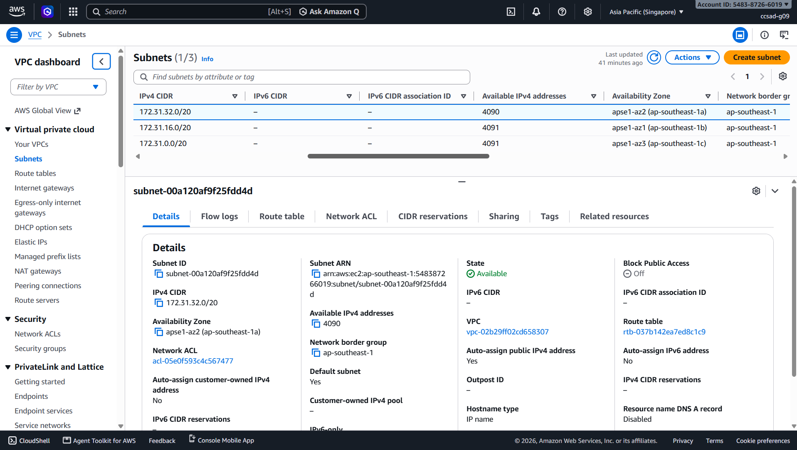
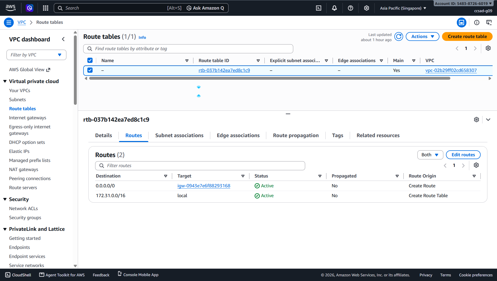
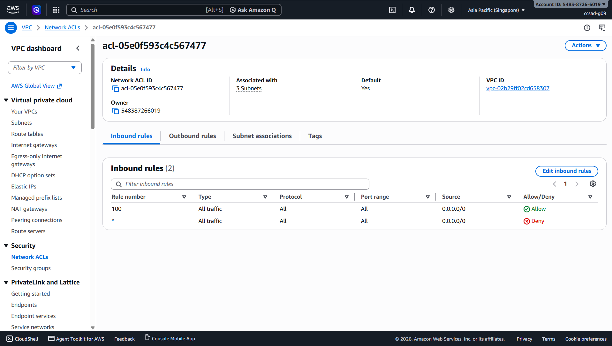
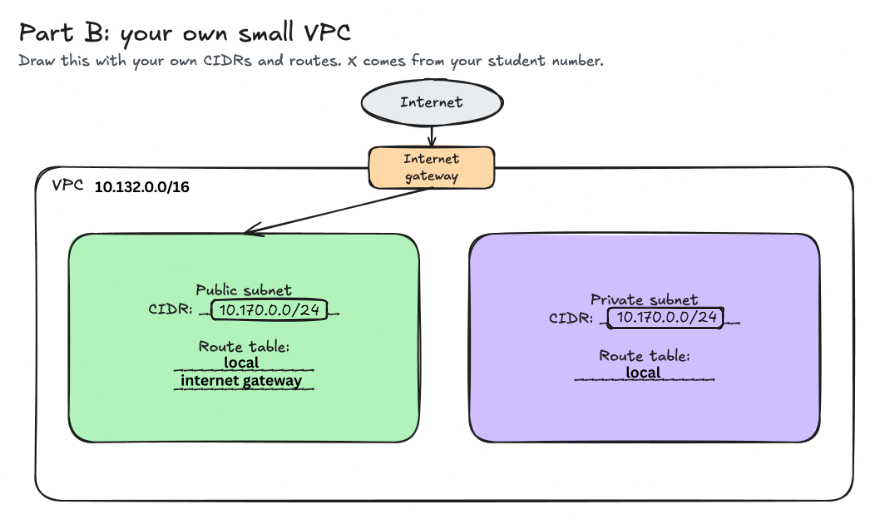

# Assignment 2 Submission

<!--
How to use this template:

1. Copy this file to submissions/assignment-2/<your-github-username>/submission.md
2. Replace every answer placeholder with your own answer. Delete the angle brackets too.
3. Save your four images in the same folder, with the exact file names below.
4. Do not write your full name or your student number in this file.
-->

## About me

- GitHub username: ItsuDev
- Section: CCSAD
- IAM user name that I signed in with: ccsad-g09
- X: 170

---

## Part A. Explore

### A1. The VPC

Default VPC IPv4 CIDR:

172.31.0.0/16

Number of addresses in that CIDR:

65,536

### A2. The subnets

| Availability Zone | IPv4 CIDR |
| --- | --- |
| apse1-az2 (ap-southeast-1a) | 172.31.32.0/20 |
| apse1-az1 (ap-southeast-1b) | 172.31.16.0/20 |
| apse1-az3 (ap-southeast-1c) | 172.31.0.0/20 |

Screenshot 1. Save it as `screenshot-1-subnets.png` in your folder. The image line below shows it.

### A3. Available addresses

Available IPv4 addresses in each subnet:

4090 4091 4091

Why is the number lower than 4,096?

A /20 subnet provides 4,096 IPv4 addresses, but AWS reserves five in every subnet (for the network, VPC router, DNS, future use, and broadcast), leaving 4,091 usable addresses.

What uses the missing address in the subnet with the lowest number?

The subnet with 4,090 available addresses has one IP address already in use by an active resource, like an EC2 instance or network interface.

### A4. The route table

| Destination | Target |
| --- | --- |
| 0.0.0.0/0 | igw-0943e7e6f88293168 |
| 172.31.0.0/16 | local |

Screenshot 2. Save it as `screenshot-2-routes.png` in your folder. The image line below shows it.

### A5. Public or private

Are the default subnets public or private? Which route proves it?

The default subnets are public because their route table directs 0.0.0.0/0 traffic to igw-0943e7e6f88293168, giving resources with public IPv4 addresses direct internet access.

### A6. The internet gateway

State of the internet gateway:

It is Attached.

What happens to the default subnets if the gateway is detached?

The default subnets lose internet access and effectively become private—internal VPC traffic still works via the local route, but all traffic through the Internet Gateway stops.

### A7. NAT gateways

Number of NAT gateways:

It is 0.

Can a server in a new private subnet download updates? Why?

No. Without a NAT Gateway in the default VPC, a server in a private subnet has no internet route for updates—you would have to create a NAT Gateway in a public subnet and point the private subnet's route table to it.

### A8. The network ACL

| Rule number | Source | Allow or Deny |
| --- | --- | --- |
| 100 | 0.0.0.0/0 | Allow |
| 0 | 0.0.0.0/0 | Deny |

How is a network ACL different from a security group?

A NACL is a stateless, subnet-level firewall that processes allow and deny rules in numerical order, whereas a security group is a stateful, instance-level firewall that uses only allow rules.

Screenshot 3. Save it as `screenshot-3-network-acl.png` in your folder. The image line below shows it.

### A9. The default security group

Inbound rule (type and source):

sgr-0b795189f3efb993c Type: All traffic Soruce: sg-0c5b6d4081cf0a534

Which resources can send traffic to an instance that uses it?

Only resources that also use this same security group can send traffic in.

---

## Part B. Prepare

### B1. Plan two subnets

- Public subnet CIDR: 10.170.0.0/24
- Private subnet CIDR: 10.170.1.0/24

### B2. Route tables

Route table of the public subnet:

| Destination | Target |
| --- | --- |
| 10.170.0.0/16 | local |
| 0.0.0.0/0 | internet gateway |

Route table of the private subnet:

| Destination | Target |
| --- | --- |
| 10.170.0.0/16 | local |

### B3. My VPC diagram

Tool used (Excalidraw, draw.io, Lucidchart, or paper):

Excalidraw

Save your diagram as `vpc-diagram.png` in your folder. The image line below shows it.

### B4. Predict a change

Can you still open the web page from your laptop? Why?

No. Without the `0.0.0.0/0` route to the internet gateway, there is no route for internet traffic.

Can the instance still reach another instance in the VPC? Why?

Yes. The local route still allows traffic between subnets in the same VPC.

### B5. Place a database

Which subnet gets the database? Why?

The private subnet gets the database because a database should not be directly accessible from the internet.

### B6. My question about VPCs

What is your question, and what made you think of it?

How does a VPC keep traffic between different subnets secure? I thought of this because the route table controls where traffic goes, but I wanted to understand how traffic is controlled between subnets.
